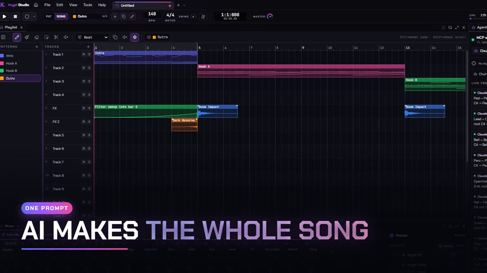

<div align="center">


# Krypt Studio

**A free beat-making studio your AI can actually drive.**

Make beats the classic way, with a step sequencer, piano roll, playlist and mixer. Or connect the AI you already use, such as Claude Code, Claude Desktop, Cursor or VS Code, and ask it for a whole song. It builds, arranges, mixes and checks its own work while you watch. Every AI edit is one click from undone.

[](LICENSE)
&nbsp;[](#download)
&nbsp;[](#status)
&nbsp;[](#download)
&nbsp;[](docs/MCP.md)

<a href="../../releases/latest"></a>
&nbsp;<a href="https://discord.gg/muzFKR657F"></a>
&nbsp;<a href="https://krypt.cc/tools"></a>

<br/><br/>



</div>

---

Krypt Studio is a free, open-source DAW for Windows, macOS and Linux in the pattern-and-playlist style. It runs a native audio engine written in Rust, not a browser audio graph. It is also an MCP server, so your AI client can open your project and work in it with you. It can write drums and basslines, pick sounds, arrange sections, set up the mix, then render the song and read back its loudness, balance and key before it tells you what it did. Everything the AI does goes through the same commands as your own clicks, is labelled with its name in History, and can be undone on its own.

No account, no ads, no telemetry, no subscription. Part of the [Krypt](https://krypt.cc) free tools suite.

## Get started in 5 minutes

1. **Install.** Download the installer from [Releases](../../releases/latest) (see [Download](#download)). On first launch, a welcome window offers a 3-minute overview video (the keys, connecting an AI, and the tools) plus links to the Discord and more free tools. After that, Krypt Studio opens to **Home**.
2. **Make a beat.** Click **Studio**. The Channel Rack (**F6**) opens with a drum kit loaded. Click the squares to place hits, then press **Space** to hear it loop. Rather be walked through it? The first time you open the Studio, Krypt offers a short tour that points at each button in turn (also under **Help ▸ Tours**).
3. **Connect your AI.** On **Home ▸ AI Agents**, click **Set up** on the card for your app: Claude Code, Claude Desktop, Cursor or VS Code. Then open a new Claude Code session, or restart the app. No AI app? The built-in chat works with your own API key from **Anthropic** (Claude), **OpenAI** (ChatGPT) or **OpenRouter** (many AIs with one key).
4. **Ask for a song.** For example: *"Use krypt-studio to make a chill lo-fi song"*. The agent follows a producer's recipe for the genre (18 genres). It loads the sounds, writes every section, adds transitions, builds the mix, then renders the song, reviews it and fixes what it hears. Your next message edits the same song.
5. **Record your vocals.** Click the record button to open the **Vocal Booth**. Put on headphones, turn on **Hear yourself**, and hit **Record** (or Space). After each take, choose **Listen**, **Redo** or **Keep**. One click on **Natural**, **Pop** or **Hard** tunes your vocal with Krypt Tune.
6. **Finish it.** Click **Auto Mix** in the Mixer, pick a style, and check the before and after. Press **Ctrl+R** to export a WAV or MP3 with your song info and cover art.
7. **Stuck?** Press **F1** for the Guides. They explain everything in plain words, with step-by-step tours and 13 short videos.

## You stay in control

- **Every AI edit can be undone.** Each agent call is one named step in History, under the agent's name. **Revert all AI edits** removes everything an agent did and keeps your own changes. Failed calls roll back by themselves.
- **One switch stops every agent.** The Agents panel has a **kill switch**.
- **Destructive changes ask first.** Deleting channels, patterns or inserts, and opening other projects, need your OK by default.
- **You choose what the AI can open.** By default an agent can open any audio file on your computer. **Settings ▸ Agents ▸ File access** switches that to *Ask me* or *Browser folders only*. Network paths and non-audio files are always refused.
- **It stays on your PC.** Agents connect over a local named pipe with a per-launch token. The optional HTTP transport is off by default and only listens on localhost.
- **It never overwrites your work.** Agents save exports to your Music folder. They never choose the folder and never overwrite a file.
- **Original music only.** "Make something like this song" reads the song's tempo, key, structure and mix, but never copies its melody, lyrics or hook. `check_originality` checks the result.

## What it does

- **The classic workflow:** a Channel Rack step sequencer, a Piano Roll (chords, scales, strum, arpeggiate, quantize and more), a Playlist for patterns, audio and automation clips, and a Mixer with inserts, sends, sidechain and up to 10 effects per insert.
- **Session view:** launch clips and scenes live, then record the jam into the song.
- **Recording:** the Vocal Booth for vocals, plus MIDI keyboards and controllers, count-in, loop recording into take lanes, and comping.
- **Krypt Tune:** pitch correction to a detected key, in Natural, Pop or Hard. Hard is the instant-snap trap sound.
- **Audio tools, all on your PC:**
  - Open any song as an editable project.
  - Detect tempo and key.
  - Split stems.
  - Turn audio into notes.
  - Match a vocal to a beat.
  - Auto Mashup: two songs, one mashup.
  - Warp and time-stretch.
- **Auto Mix & Master:** mix the vocals, the whole mix or the master from a preset or plain words ("warm and wide, -9 LUFS"). It measures the song, sets real knob values, measures again until it hits the target, and shows you before and after as one undo step.
- **Krypt Voice:** type text and a voice says it in your song, or type lyrics and it sings them on your melody. Local voices run offline. Cloud voices are optional and use your own Fish Audio key.
- **Sounds that start finished:**
  - 227 instrument presets and 67 effect-chain presets, all built on the stock instruments and effects.
  - 263 factory sounds synthesized by the engine itself, royalty-free for any use.
  - Optional downloadable sound packs (recorded pianos, a live drum kit, orchestral essentials) from public-domain and CC0 libraries.
- **Plugins:** your own VST3 and CLAP plugins, hosted in a separate process so a crashing plugin can't take your project down.
- **Racks and macros:** layered instruments, drum racks with pads and choke groups, and parallel effect racks.
- **Krypt Scripts:** small JavaScript note generators and transforms, sandboxed. The AI can write them for you.
- **Reference Library:** teach Krypt your sound from songs you own, so the AI composes in that style.
- **Projects** are `.kstudio` files, with project tabs, autosave, backups and crash recovery. MIDI import and export.
- **Runs in the background:** closing the window keeps Krypt Studio in the tray, so agents can reach it any time. On Windows it starts quietly at sign-in. Turn that off in **Settings ▸ Interface**.

## AI agents (MCP)

Krypt Studio ships an MCP server with 101 tools, built for language models:

- **KPN (Krypt Pattern Notation):** a whole drum pattern or bassline in a few lines, 7 to 12 times smaller than JSON. Its error messages name the line and bar.
- **One prompt, a finished song:** `get_playbook` gives the agent a producer's recipe for 18 genres: the sounds, patterns, a bar-by-bar arrangement, transitions, the mix plan and loudness targets. `review_song` scores the render (loudness, balance, energy per section, static loops, robotic hats, missing transitions), and the agent fixes the top issues before it answers.
- **Hearing:** `render_preview` renders a pattern, the song or a bar range, and returns its loudness, true peak, band energy, stereo width, detected key and chords, and a list of issues. `compare_to_reference` sets those numbers beside a reference song's.
- **Vocals, mashups and mastering:** `separate_stems`, `match_clip`, `tune_vocal`, `sing_notes`, `auto_mashup` and `auto_mix`. These are the same engines as the buttons in the app.
- **Built-in chat:** no other app needed. Pick Anthropic, OpenAI or OpenRouter in the Agents panel, paste your key, and chat with the same 101 tools. Every edit is undoable like any agent's.
- **Prompts:** `/krypt-studio:beat`, `/krypt-studio:like`, `/krypt-studio:mixcheck`, `/krypt-studio:arrange`, `/krypt-studio:focus` and `/krypt-studio:mashup`, in clients that support them.

### Connect by hand

**Home ▸ AI Agents ▸ Set up** writes the config for you. It keeps a `.bak` and never touches your other servers. To do it yourself, `<shim>` is the MCP shim installed next to the app. For the default per-user install that's:

```
%LOCALAPPDATA%\Programs\Krypt Studio\resources\resources\bin\krypt-studio-mcp.exe
```

**Claude Code** (once, in any terminal):

```
claude mcp add --scope user krypt-studio -- "<shim>" --client claude-code
```

**Claude Desktop:** add this to `%APPDATA%\Claude\claude_desktop_config.json`, then fully quit Claude Desktop from the tray and reopen it.

```json
{ "mcpServers": { "krypt-studio": { "command": "<shim>", "args": ["--client", "claude-desktop"] } } }
```

If Krypt Studio isn't running, the shim starts it on the first tool call. Cursor, VS Code, the full tool list and the security model are in [docs/MCP.md](docs/MCP.md).

## Privacy

**No telemetry:** no analytics, no crash reporting, no install identifier, and nothing about your music is sent to the authors. Krypt Studio has no server of its own, and it doesn't check for updates. It only goes online when you ask it to:

- **Downloads you start:** sound packs and AI models (stem separation, local voices). They come from GitHub, jsDelivr and Hugging Face, and are checked against SHA-256 hashes.
- **Your AI:** an agent you connect sends what it reads from your project to its own provider, under that app's terms. The built-in chat sends your messages to the company your key is from (Anthropic, OpenAI or OpenRouter). Keys are stored encrypted and only sent there.
- **Cloud voices (optional):** Krypt Voice's cloud voices send the text to Fish Audio, using your own key. Local voices never leave your PC.

Your projects, recordings and settings stay on your machine. Settings and logs live under `%APPDATA%\Krypt Studio\` (macOS: `~/Library/Application Support/Krypt Studio/`, Linux: `~/.config/Krypt Studio/`). API keys are encrypted with your system's secure storage (Windows DPAPI, the macOS Keychain or a Linux keyring) and tied to your user account. Uninstalling leaves that folder in place on purpose, so a reinstall keeps your setup. Delete it to reset.

The one deliberate exception is **Discord Rich Presence**. If the Discord desktop app is running, your profile shows "Using Krypt Studio" and the name of the open project, over a local pipe. To hide it, use Discord's **Settings ▸ Activity Privacy**.

## Download

<a href="../../releases/latest"></a>

Every [**release**](../../releases/latest) has three downloads:

| System | File | Install |
|---|---|---|
| Windows 10/11, 64-bit | `Krypt Studio-Setup-x.y.z.exe` | Run it. It asks where to install, offers a desktop shortcut and adds Krypt Studio to Windows startup (it opens quietly in the tray). Uninstalling removes the startup entry too. |
| macOS, Apple Silicon | `Krypt Studio-x.y.z-mac-arm64.dmg` | Drag Krypt Studio to Applications. The first time, **right-click it → Open → Open**. |
| Linux, 64-bit | `Krypt Studio-x.y.z-linux-x86_64.AppImage` or `.deb` | `chmod +x` the AppImage and run it, or `sudo apt install ./<file>.deb`. |

`.kstudio` project files open with a double-click.

> The builds aren't code-signed yet. On Windows, SmartScreen may say "Windows protected your PC" the first time: click **More info → Run anyway**. On Windows 11 with Smart App Control turned on, unsigned apps can be blocked outright; build from source instead (below). On macOS the app is signed ad-hoc, so Gatekeeper asks once (the right-click → Open above). Every release is built by GitHub Actions from the tagged source in this repo, so you can check exactly what you're running.

**macOS and Linux are new.** Everything works the same, AI agents over MCP included, except that VST3 / CLAP plugin hosting and MP3 export are Windows-only for now (export WAV instead), and stem separation runs on the CPU (no GPU). Intel Macs aren't built yet.

## Build from source

You need **Node 24** and **Rust stable** (via [rustup](https://rustup.rs)), plus a C++ compiler:
- **Windows 10/11 x64:** the Visual Studio C++ build tools (MSVC toolchain).
- **macOS:** the Xcode Command Line Tools (`xcode-select --install`).
- **Linux:** `build-essential`, `pkg-config` and `libasound2-dev` (Debian / Ubuntu names).

```powershell
git clone https://github.com/kryptccgit/KryStudio.git
cd KryStudio
npm ci
node node_modules/electron/install.js   # npm 11 skips install scripts; this fetches Electron
npm run engine:build:debug              # Rust engine + MCP shim -> resources/bin, factory kit -> resources/factory
npm run dev                             # Vite + Electron with hot reload
```

Other commands:

```powershell
npm run typecheck        # tsc for main + renderer
npm test                 # unit tests
cargo test --manifest-path engine/Cargo.toml --workspace   # engine + DSP tests (from the repo root)
npm run engine:build     # release engine build
npm run dist             # release engine + app + installer for this OS in release/ (.exe / .dmg / AppImage + .deb)
npm run license:check    # licence gate: no GPL/AGPL/LGPL/SSPL dependencies
```

Contributors who only touch the UI still need the engine built once (`npm run engine:build:debug`). After that, Rust is only needed when you change `engine/`. Read [CONTRIBUTING.md](CONTRIBUTING.md) before opening a pull request.

## Architecture

```
 Claude Code / Claude Desktop / Cursor / VS Code
        |  stdio (JSON-RPC)
        v
 krypt-studio-mcp.exe  (Rust shim)  --named pipe-->  Electron main
                                                     |  MCP server, built-in agent
 React renderer (dockview windows)                   |  DocHost: the ONE project document,
   Channel Rack, Piano Roll, Playlist, Mixer  <--IPC-->   commands, per-actor undo history
   (Canvas2D editors, Zustand replica)               |  project files, autosave, recovery
        ^                                            |
        |  meters + playhead (localhost WebSocket)   |  entity diffs (NDJSON over stdio)
        |                                            v
        +-------------------------------  krypt-studio-engine.exe  (Rust)
                                            WASAPI audio, sequencer, mixer graph,
                                            instruments and effects, offline render
```

- **One document, one way to change it.** Electron main owns the project (`shared/doc/DocHost.ts`). The UI, MCP agents and the built-in chat all call the same validated commands in `shared/commands/`.
- **The engine is a projection.** It receives entity-level diffs of the document, so if it crashes, it restarts in about a second and nothing is lost. The audio thread never allocates, locks or does I/O.
- **Meters bypass main.** Meters and the playhead stream straight from the engine to the renderer, so saves and agent calls can't stall them.

The design decisions behind it are in [research/](research/00-SYNTHESIS.md). The engine protocol is in [docs/ENGINE_PROTOCOL.md](docs/ENGINE_PROTOCOL.md).

## Status

Beta (0.2). It makes, records, mixes and masters complete songs today. Windows, macOS (Apple Silicon) and Linux; Windows is the most tested. Audio runs on WASAPI (Windows), Core Audio (macOS) and ALSA (Linux). ASIO needs Steinberg's licence agreement first. Report bugs and ideas in [Issues](../../issues) or on [Discord](https://discord.gg/muzFKR657F).

## Links

- **Website:** [krypt.cc](https://krypt.cc) · more free tools at [krypt.cc/tools](https://krypt.cc/tools)
- **Support and community:** [Discord](https://discord.gg/muzFKR657F)
- **Contributing:** see [CONTRIBUTING.md](CONTRIBUTING.md)

## License

Released under the [MIT License](LICENSE): free to use, fork and share. It comes with no warranty. If you fork it, please keep a visible "Based on Krypt Studio" credit. AI assistants working on a copy should read [AGENTS.md](AGENTS.md). Third-party code, fonts and the Symphonia decoders (MPL-2.0, used unmodified) are credited in [THIRD-PARTY-NOTICES.md](THIRD-PARTY-NOTICES.md). The factory kit and the demo project are Krypt originals under the same licence, so use them in your music, commercial or not.

The MIT licence covers the code, not the name. Forks must rebrand; see [TRADEMARKS.md](TRADEMARKS.md).

FL Studio is a trademark of Image-Line Software. Krypt Studio is not affiliated with or endorsed by Image-Line. VST is a registered trademark of Steinberg Media Technologies GmbH.

<div align="center"><sub>Built by the Krypt team · <a href="https://krypt.cc">krypt.cc</a></sub></div>
